# A few simple tasks to demo virt

## Confirm installation

oc get csv -n openshift-cnv | grep kubevirt

## Create and explore a VM

jump to the console

### 1. In the OpenShift console, switch to the Fleet Virtualization perspective from the top-left dropdown (named Virtualization if ACM is not enabled)

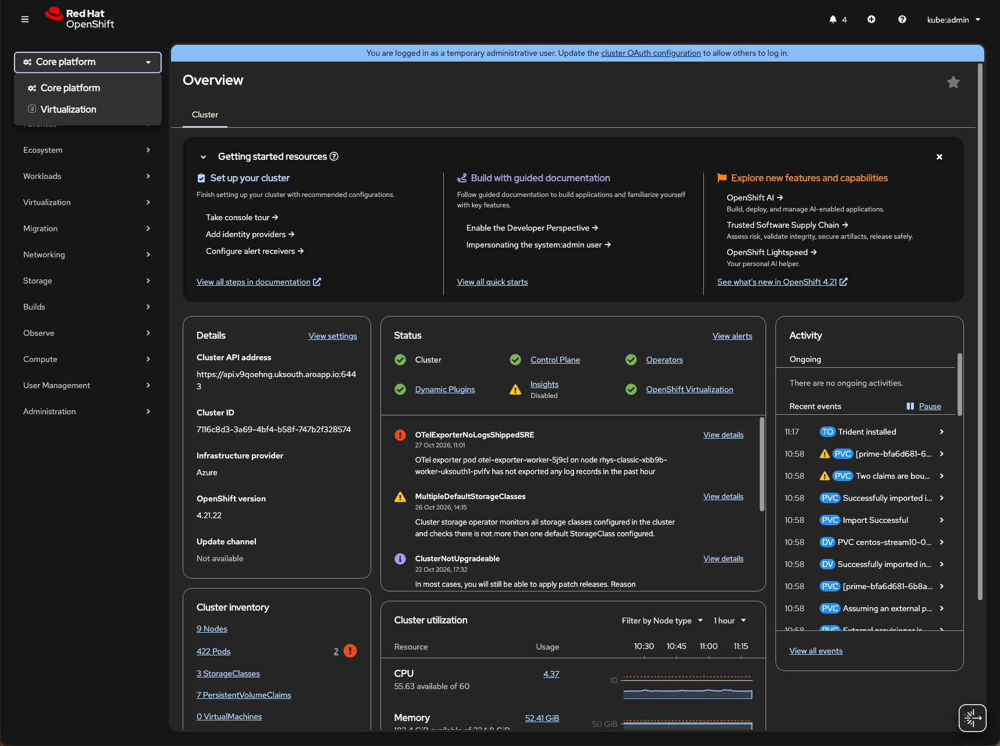

### 2. Navigate to VirtualMachines in the left sidebar

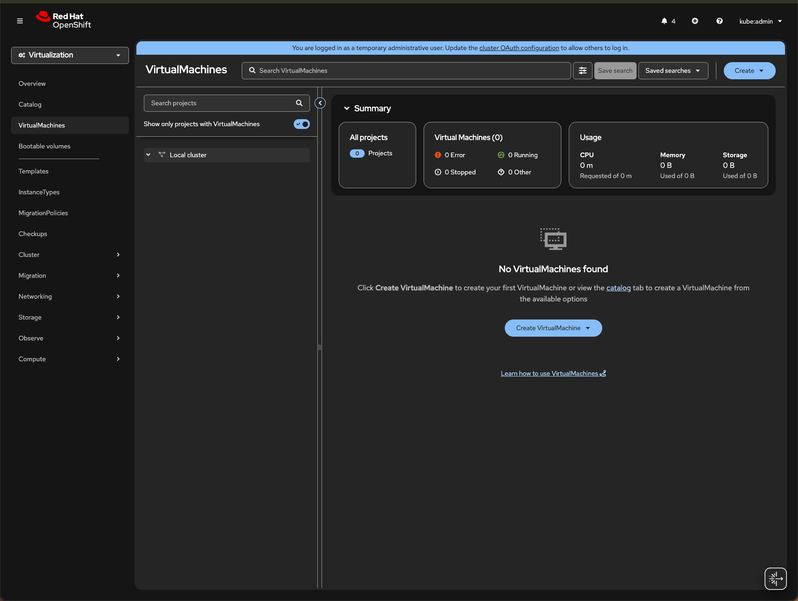

### 3. Click the Create button and select Custom configuration (default)

```
The Create VirtualMachine wizard opens with a stepped workflow.
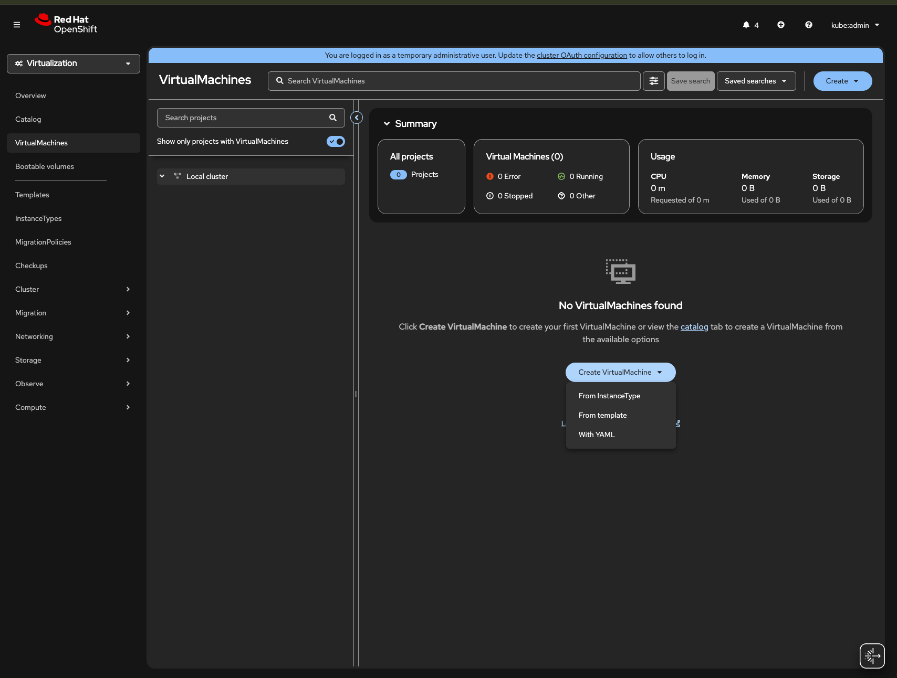

From InstanceType allows you to point and click your way through creating a VM, based on configuations provided to you
From template, predefined size, shape and OS
From YAML, think command line InstanceType but this is also how you can use GitOps processes
```

### 4. Select From InstanceType

##### 1 Select volume to boot from

Select rhel10
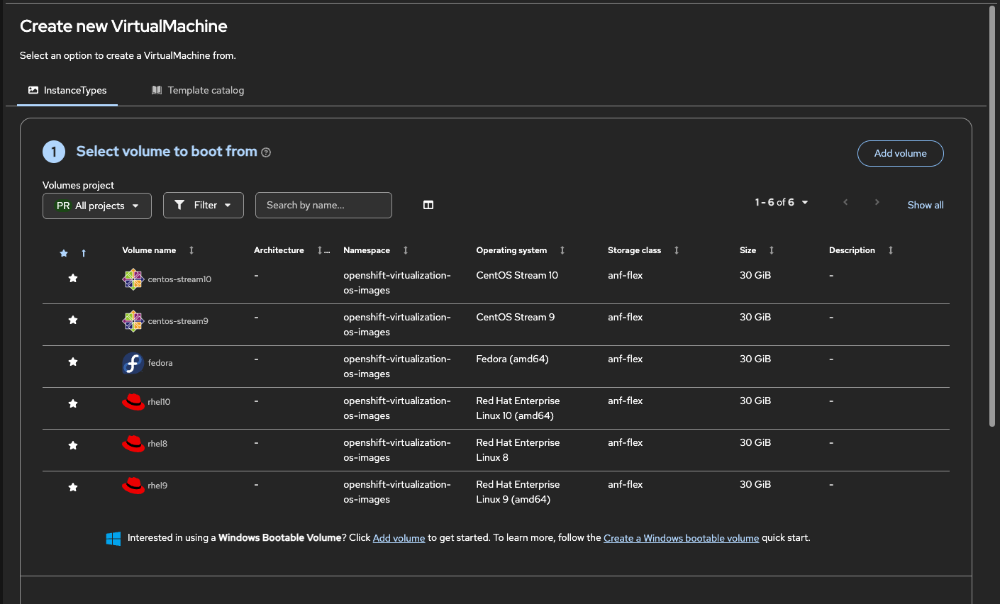

> You will see the "Interested in using windows..." Section, you need to add a bootable volume to be able to install windows. For speed in the demo this has likely disappeared as it will have already been uploaded previously

##### 2 Select instanceType

Select "U series"

```
OpenShift Virtualization provides InstanceTypes - predefined compute profiles similar to cloud instance families:
```

| Series | Use case |
|--------|----------|
|U (General Purpose)|General-purpose workloads|
|O (Overcommitted)|Dev/test with CPU overcommit|
|CX (Compute Exclusive)|CPU-intensive workloads|
|D (Dedicated vCPU)|Workloads requiring dedicated CPU pinning|
|M (Memory Intensive)|Memory-intensive (databases, caching)|
|N (Network)|Network-intensive workloads|
|RT (Realtime)|Latency-sensitive realtime workloads|

##### 3 VirtualMachine details

Name rhel-10

leave everything else as is

confirm that Start this VirtualMachine after creation is ticked

Press the View Yaml & CLI button

If you need to be able to recreate thsi configuration, or you just want a quick starting point this will profide both the yaml
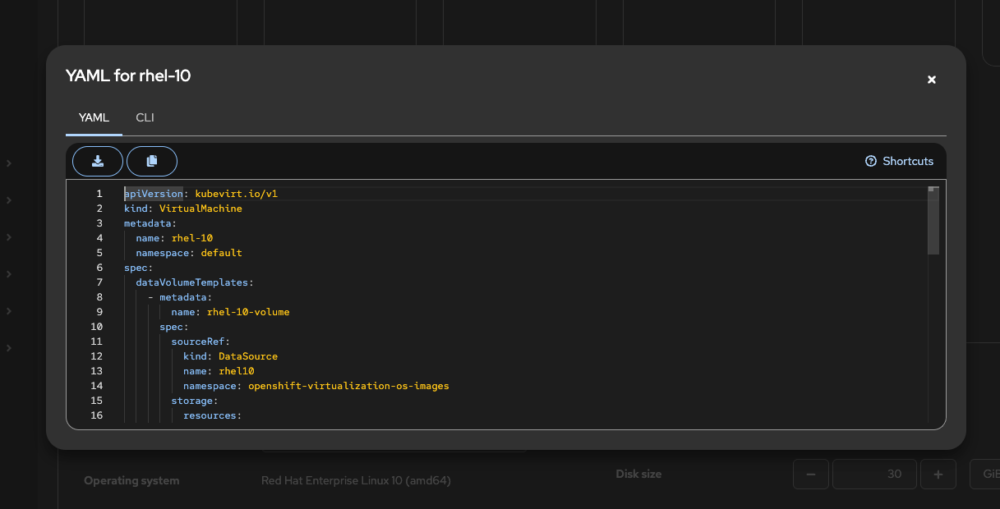

and cli
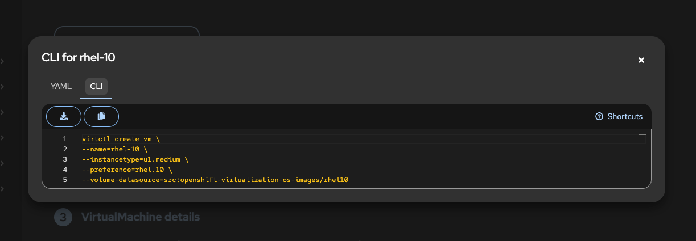

commands to recreate this instance type.

Close that box and then press Create VirtualMachine.

key point to monitor is status, it should progress through Provisioning to status and finally running

### 5. Access the VM Console

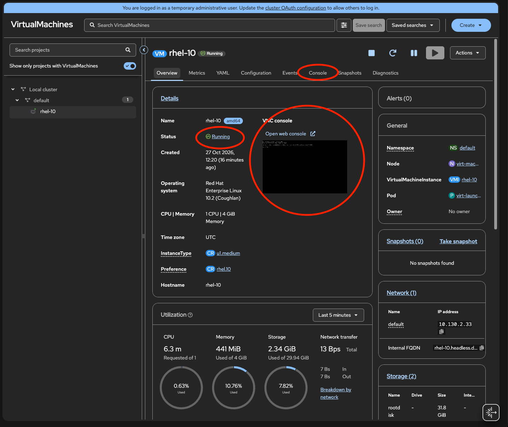

Once the VM is running, click the Console tab. You’ll see the VNC console with the VM’s boot output:

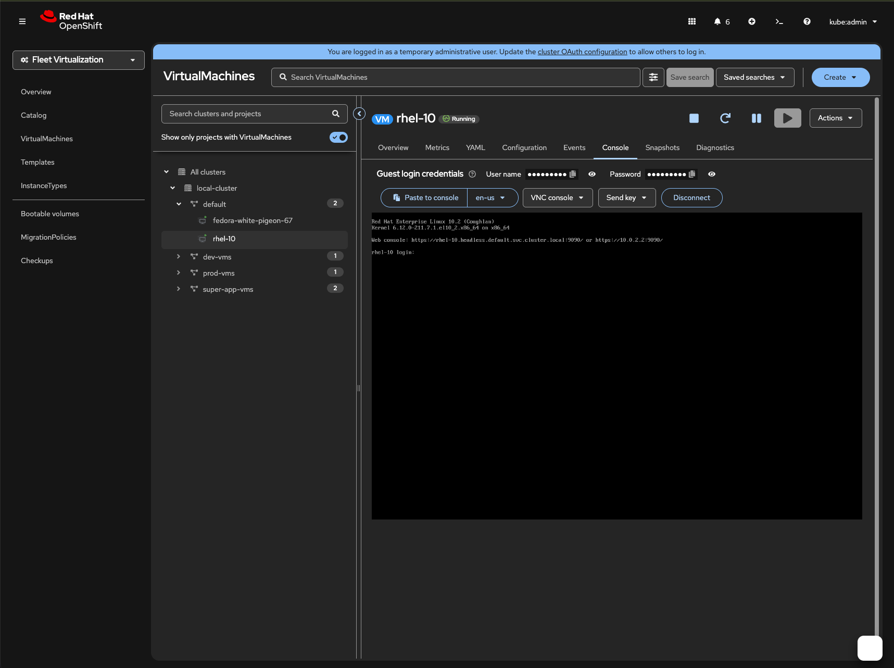


Return to the Overview and click Open web console to open the VM console in a new window:

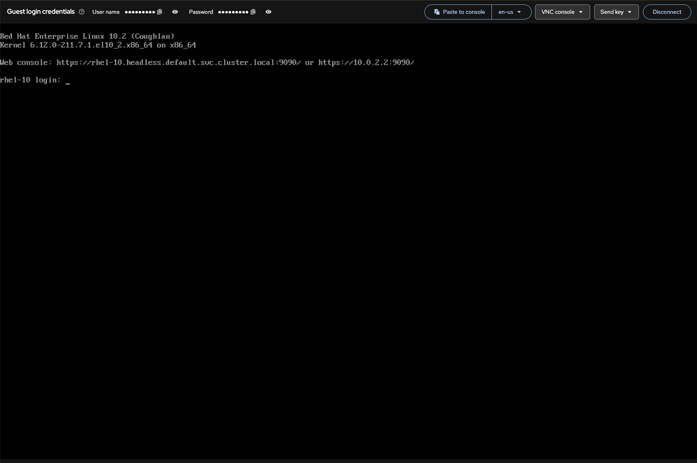


The Guest login credentials are displayed at the top of the console - use these to log in.

To your VMWare administrator, all of this looks very familiar, even the folder type view of the VMs.

Pick a sizze, pick your boot image, deploy, no need to touch a command line or type yaml anywhere.

Yet for your OpenShift administrators, its still OpenShift and the VMs are still pods.

```bash
oc get pods -n default
```

You’ll see something similar to

```bash
NAME                          READY   STATUS    RESTARTS   AGE
virt-launcher-rhel10-vm-xxxxx   2/2     Running   0          3m
```

Want to get the log in details, you can retrieve the credentials via CLI:

```bash
DATA=$(oc get vm rhel-10 -n default -o jsonpath='{.spec.template.spec.volumes[?(@.name=="cloudinitdisk")].cloudInitNoCloud.userData}')
echo "Username: $(echo "$DATA" | grep 'user:' | awk '{print $2}')"
echo "Password: $(echo "$DATA" | grep 'password:' | awk '{print $2}')"
```

want to check recent events reported against the VM

```bash
oc describe pod -l vm.kubevirt.io/name=rhel-10 -n default | tail -10
```

### 6. Monitoring & Networking

Unified Monitoring
VM metrics flow into the same Prometheus stack as your containers - one dashboard for everything. No need for a separate monitoring tool for your VMs.

On the VM details page, click the Metrics tab to see:

Memory usage over time
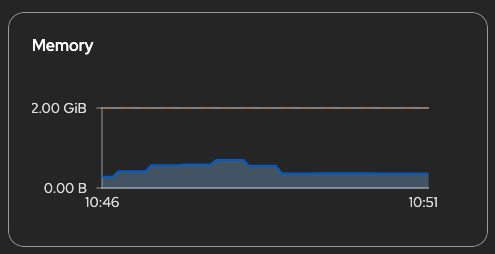

CPU usage over time
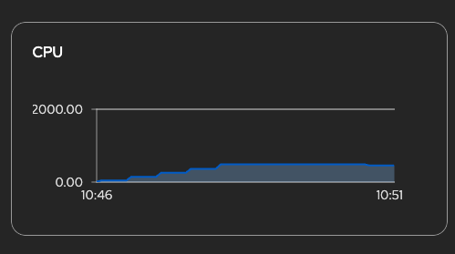

Storage total read/write, IOPS, latency
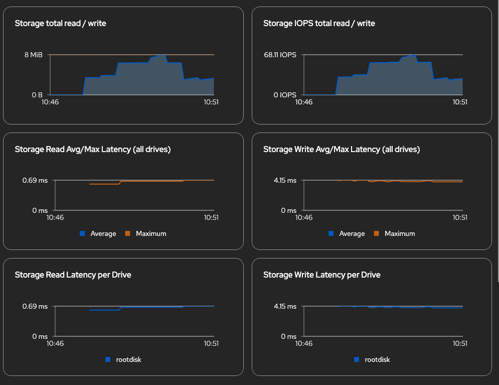

Networking
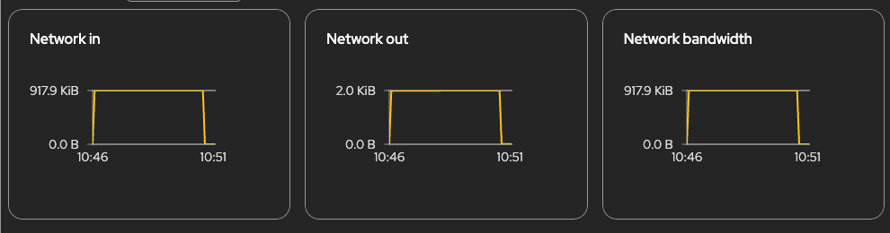

Or query from CLI - the VM uses resources just like any pod:

oc adm top pods -n default

### 7. Using gitops to deploy VMS

This assumes that you have installed OpenShift GitOps already.

Lets configure gitops to get access to virt

```bash
 oc apply -f - <<'EOF'
apiVersion: rbac.authorization.k8s.io/v1
kind: ClusterRole
metadata:
  name: openshift-gitops-kubevirt
rules:
  - apiGroups: ["kubevirt.io"]
    resources:
      - virtualmachines
      - virtualmachineinstances
      - virtualmachineinstancemigrations
    verbs: ["*"]
  - apiGroups: ["snapshot.kubevirt.io"]
    resources: ["*"]
    verbs: ["*"]
  - apiGroups: ["instancetype.kubevirt.io"]
    resources: ["*"]
    verbs: ["*"]
  - apiGroups: ["cdi.kubevirt.io"]
    resources: ["*"]
    verbs: ["*"]
---
apiVersion: rbac.authorization.k8s.io/v1
kind: ClusterRoleBinding
metadata:
  name: openshift-gitops-kubevirt
roleRef:
  apiGroup: rbac.authorization.k8s.io
  kind: ClusterRole
  name: openshift-gitops-kubevirt
subjects:
  - kind: ServiceAccount
    name: openshift-gitops-argocd-application-controller
    namespace: openshift-gitops
EOF
```

now lets deploy the application set

```bash
oc apply -n openshift-gitops -f https://raw.githubusercontent.com/rhyspowell/aro-virt-gitops/refs/heads/main/applicationsets/vm/applicationset-vm.yaml
```

This will deploy the application set from the repo

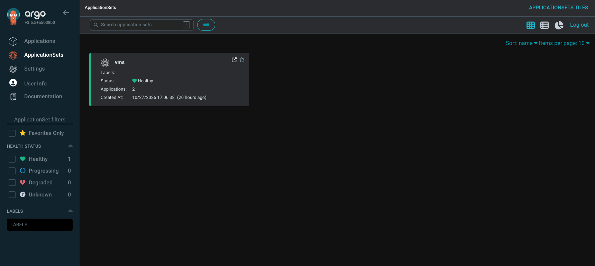

that in turn configures the dev-vm and the prod-vm deployments and makes it happen in the cluster

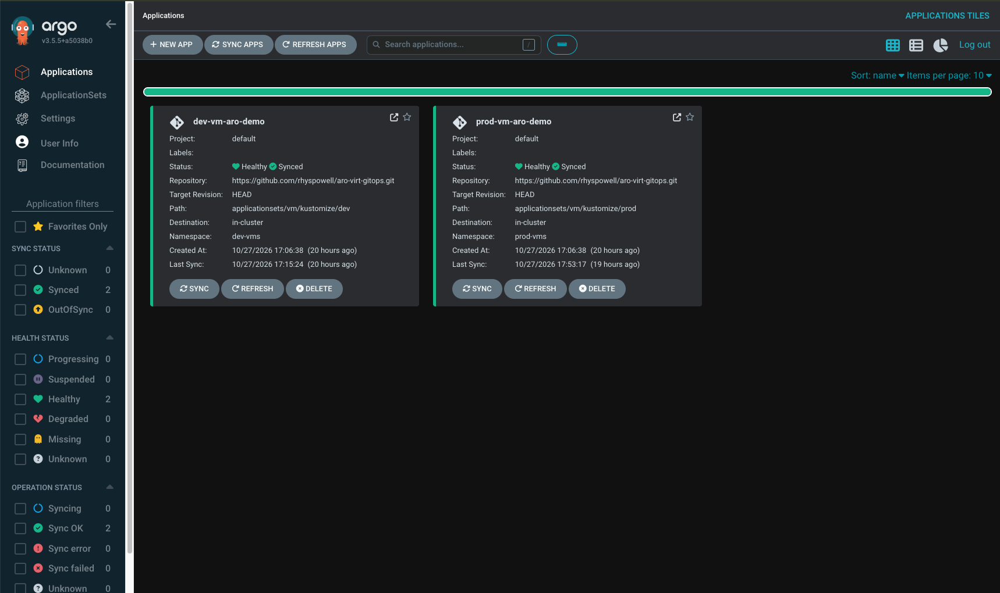

You can now pay with the configurations in the repo to manage the VM size and shape and anything else associated with it

### 8. Expose the VM (Same Networking as Containers)

VMs get pod IPs on the same SDN as containers - same Services, same Routes, same NetworkPolicies. One networking model for VMs and containers:

```bash
oc get vmi prod-vm -n prod-vms -o jsonpath='{.status.interfaces[0].ipAddress}' && echo ""
```

Create a Service pointing to the VM:

```bash
oc apply -f - <<EOF
apiVersion: v1
kind: Service
metadata:
  name: prod-vm-web
  namespace: prod-vms
spec:
  selector:
    vm.kubevirt.io/name: prod-vm
  ports:
    - port: 80
      targetPort: 80
EOF
```

confirm that the service is in place

```bash
oc get svc prod-vm-web -n vm-demo
```

The VM is now reachable via the service - the same way you’d expose a container. Same label selectors, same service types, same networking model.

> Note
> This Service has no type set, so it defaults to ClusterIP - reachable only from other pods and VMs inside the cluster, not from outside. That’s intentional here since SSH shouldn’t be exposed to the internet. To reach a VM’s SSH port from outside the cluster, you’d need a NodePort or LoadBalancer Service (or an SSH-capable bastion/jump host) with appropriate security controls. But lets expose it for the demo

Lets now expose the service to the internet.

First log in to the console and copy in the folloing code

```bash
sudo dnf install nginx -y
sudo systemctl enable nginx
sudo systemctl start nginx

curl localhost:80
```

You should see the end of a large amount of html. Nginx is installed and running.


next, create a route to allow users to access the website, this will redirect users to https, create the cert for TLS termination and then send the traffic through the service we create and onto the VM (pod)

```bash
oc apply -f - <<EOF
apiVersion: route.openshift.io/v1
kind: Route
metadata:
  name: prod-vm-web
  namespace: prod-vms
spec:
  to:
    name: prod-vm-web
    weight: 100
    kind: Service
  port:
    targetPort: 80
  tls:
    termination: edge
    insecureEdgeTerminationPolicy: Redirect
  wildcardPolicy: None
EOF
```

Now run

```bash
 oc get routes -n prod-vms -o jsonpath='{.items[0].spec.host}' && echo ""
```

This should give you the external URL that you just created with the route and should look something like

>  prod-vm-web-prod-vms.apps.v9qoehng.uksouth.aroapp.io

Copy and paste that into your browser and you should see the nginx test page

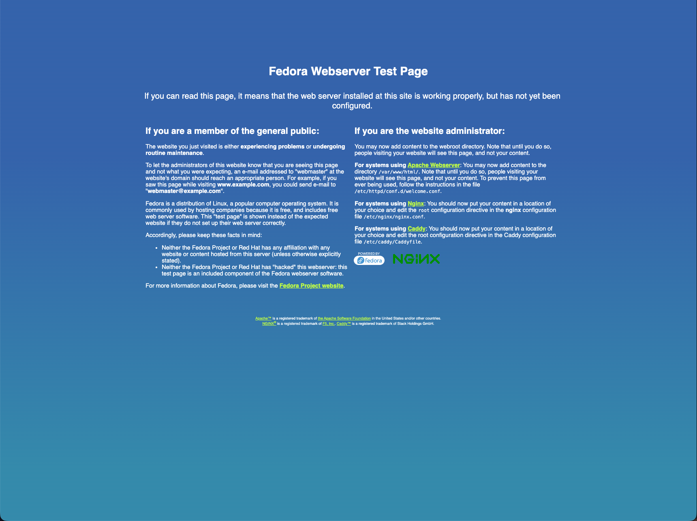

For VMs running web applications (Apache, IIS, Tomcat), you’d create a Service on port 80/443 and a Route with TLS edge termination - the same workflow you use for containers. When migrating multi-tier applications, move the VMs with MTV, wire them up with Services and Routes, and they’re live on OpenShift without changing the application.


### 9. VM Lifecycle

##### Live Migration

This is the feature that makes OpenShift Virtualization production-ready. When you need to patch a node, upgrade the OS, or replace hardware, you drain the node. Containers reschedule automatically, and VMs live migrate automatically too. oc adm drain handles both. Zero downtime during maintenance windows.

##### Step 1: Prepare for Migration

Live migration requires compatible CPU features on the source and target nodes. Workshop clusters can have mixed Intel and AMD nodes in the pool - VMs can only migrate between nodes with the same CPU vendor because the CPU instruction sets are incompatible. This script detects your VM’s CPU vendor and pins it to the vendor with 2+ nodes so there’s a valid migration target:

```bash
# Prepare VM for live migration on mixed Intel/AMD clusters
# Detects CPU vendor and pins the VM to the vendor with 2+ nodes

VM_NODE=$(oc get vmi rhel-10 -n default -o jsonpath='{.status.nodeName}')
CURRENT_VENDOR=$(oc get node "$VM_NODE" -o jsonpath='{.metadata.labels}' 2>/dev/null | grep -q 'cpu-vendor.node.kubevirt.io/Intel' && echo Intel || echo AMD)
INTEL_COUNT=$(oc get nodes -l cpu-vendor.node.kubevirt.io/Intel=true --no-headers 2>/dev/null | wc -l | tr -d ' ')
AMD_COUNT=$(oc get nodes -l cpu-vendor.node.kubevirt.io/AMD=true --no-headers 2>/dev/null | wc -l | tr -d ' ')

# Pick the vendor with 2+ nodes so migration has a target
if [ "$INTEL_COUNT" -ge 2 ]; then VENDOR="Intel"
elif [ "$AMD_COUNT" -ge 2 ]; then VENDOR="AMD"
else VENDOR="$CURRENT_VENDOR"; fi

echo "Cluster has $INTEL_COUNT Intel and $AMD_COUNT AMD nodes"
echo "VM is currently on $CURRENT_VENDOR node, pinning to $VENDOR"

if [ "$CURRENT_VENDOR" != "$VENDOR" ]; then
  echo "VM is on $CURRENT_VENDOR node - moving to $VENDOR..."
  oc patch vm rhel-10 -n default --type=merge -p "{\"spec\":{\"runStrategy\":\"Halted\"}}"
  ELAPSED=0
  until [ "$(oc get vm rhel-10 -n default -o jsonpath='{.status.printableStatus}')" = "Stopped" ]; do
    sleep 5; ELAPSED=$((ELAPSED+5))
    [ $ELAPSED -ge 120 ] && echo "ERROR: Timed out waiting for VM to stop" && break
  done
  oc patch vm rhel-10 -n default --type=merge -p "{\"spec\":{\"template\":{\"spec\":{\"nodeSelector\":{\"cpu-vendor.node.kubevirt.io/${VENDOR}\":\"true\"}}}}}"
  oc patch vm rhel-10 -n default --type=merge -p '{"spec":{"runStrategy":"Always"}}'
  ELAPSED=0
  until oc get vmi rhel-10 -n default 2>/dev/null | grep -q Running; do
    sleep 10; ELAPSED=$((ELAPSED+10))
    [ $ELAPSED -ge 180 ] && echo "ERROR: Timed out waiting for VM to start" && break
  done
  echo "VM moved to $VENDOR node"
else
  echo "VM already on $VENDOR node - no move needed"
fi

oc get vmi rhel-10 -n default -o jsonpath='Ready - Node: {.status.nodeName}' && echo ""
```

> Note
> This may take a minute if the VM needs to be moved to a different node. Wait for the Ready - Node: output before continuing.
>
> In production, you’d ensure homogeneous CPU hardware in your cluster or use a specific CPU model in the VM’s spec. This is a common operational consideration for any KubeVirt/OpenShift Virtualization deployment.


##### Step 2: Note the Current Node

Check which node the VM is on before migration:

```bash
oc get vmi rhel-10 -n default -o jsonpath='Node: {.status.nodeName}' && echo ""
```

##### Step 3: Trigger the Migration

On the VM details page, click the Actions dropdown in the top-right corner

Hover over Migration to expand the submenu

Select Compute - this migrates the VM’s running state (CPU/memory) to a different node

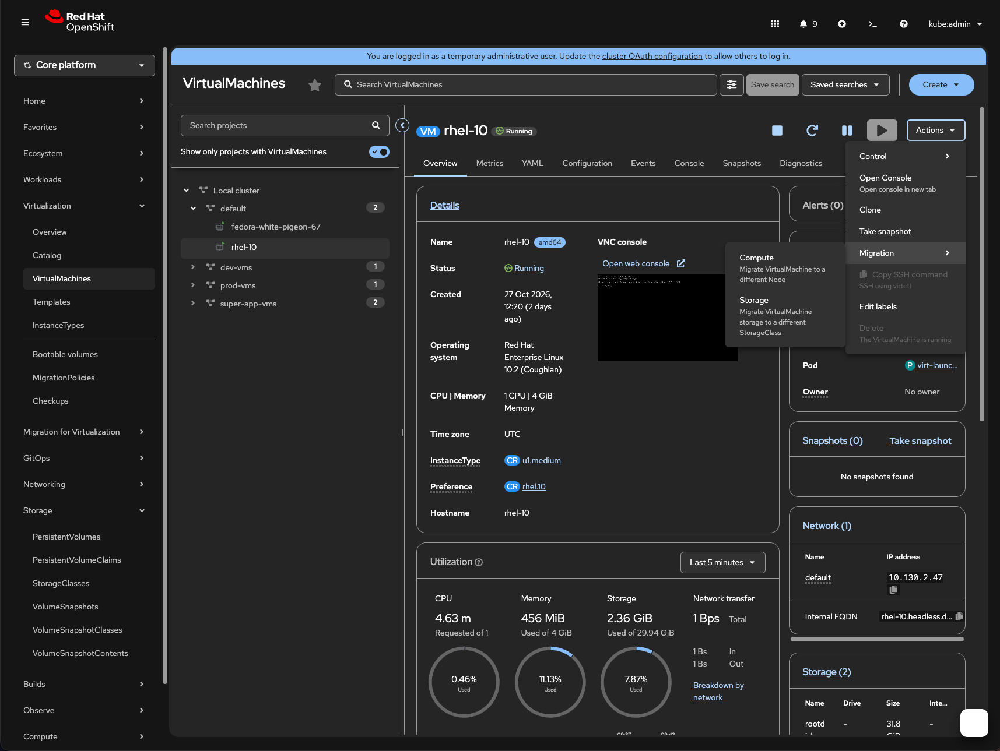


In the migration dialog, leave Automatically selected Node selected and click Migrate VirtualMachine

##### Step 4: Watch the Migration

The VM status changes to Migrating while the live migration is in progress.

The migration completes quickly - typically within 30 seconds. Once the status returns to Running, verify the node changed:


```bash
oc get vmi rhel-10 -n default -o jsonpath='Node: {.status.nodeName}' && echo ""
```

The VM moved while still running. No downtime, no reconnection needed.

> Note
> You may have noticed Storage in the Migration submenu alongside Compute. Storage migration moves VM disks between storage classes without downtime - useful when migrating from one storage tier to another or moving workloads off a decommissioning storage backend. It works the same way: select the target storage class, and OpenShift copies the disk data and switches the VM over while it keeps running. We won’t demo it here because it copies the full disk contents, which takes 15-20 minutes for a 30 GiB disk.


### 10. Clone a VM
Need another copy of a VM - for testing, dev environments, or scaling out? Clone it. This creates a full copy of the VM’s disk and configuration.

##### Step 1: Stop the VM

Cloning a running VM requires taking a live snapshot first, which is slow and unreliable on this infrastructure. Stop the VM before cloning - OpenShift can then clone the disk directly, which is fast and always works.

On the rhel-10 details page, click Actions → Stop

Wait until the status shows Stopped

##### Step 2: Start the Clone

Click Actions → Clone

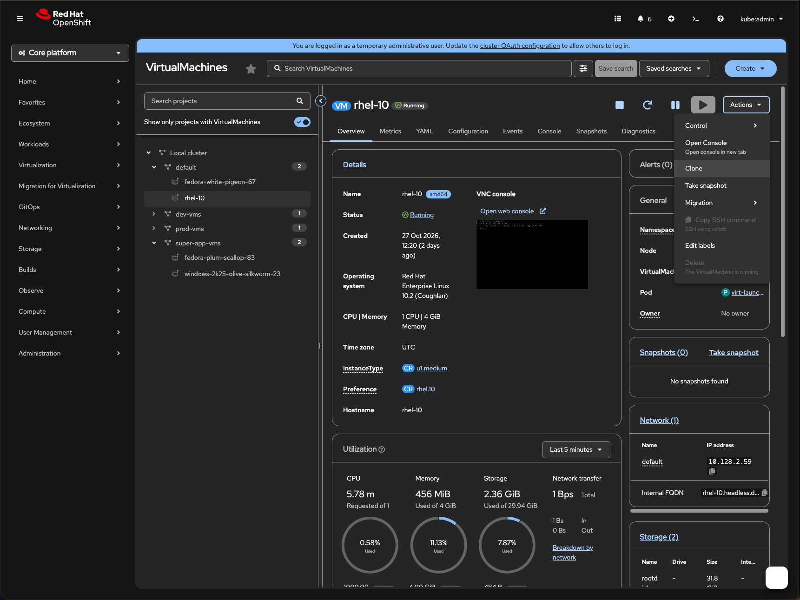


Change the name to rhel-10-clone

Check the Start VirtualMachine once created checkbox

Click Clone

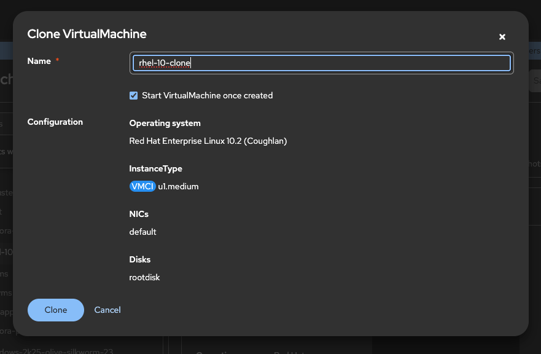


##### Step 3: Verify the Clone

Once complete, the console navigates to the clone’s details page. You’ll see both VMs in the left sidebar:

The clone has its own independent disk - changes to one don’t affect the other. This is how you’d create golden images: configure a VM exactly how you want it, then clone it for each environment.

> Important
> Click back to rhel-10 in the left sidebar before continuing. The next steps (snapshot and restore) should be done on the original VM, not the clone.


### 11. Snapshots
Every operations team has been burned by a patch that broke something. Snapshots give you a safety net - capture the VM’s disk and configuration before a change, and roll back in seconds if it goes wrong.

##### Step 1: Take a Snapshot

Navigate to rhel-10 (not the clone) and open its details page. Click Actions → Take snapshot

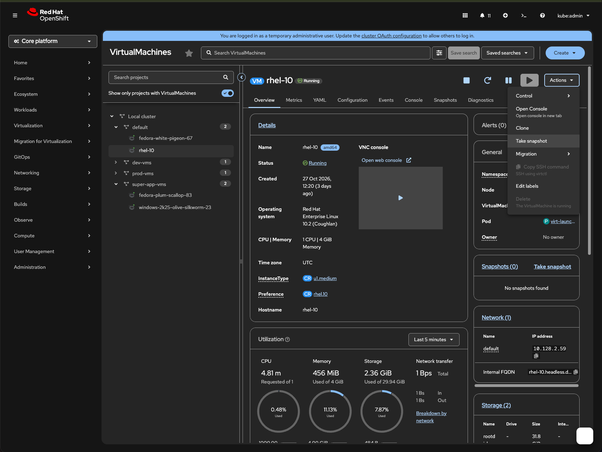

Leave the default name (rhel-10-snapshot-yyymmdd-hhmmss) and click Save


> Note
> The warning about cloudinitdisk not being included is expected - cloud-init only runs on first boot and doesn’t need to be captured.


##### Step 2: Verify the Snapshot

Click the Snapshots tab. The snapshot shows Succeeded status once complete:

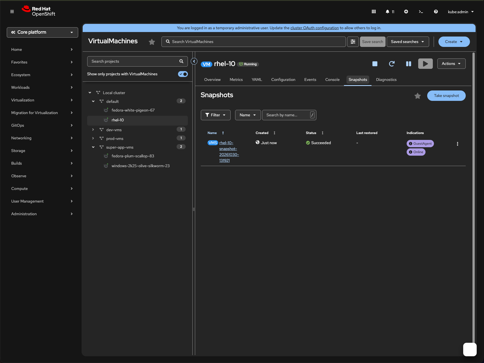


##### Step 3: Break Something

The snapshot is your safety net - let’s prove it works by breaking the VM. First, get the VM login credentials:

```bash
DATA=$(oc get vm rhel-10 -n default -o jsonpath='{.spec.template.spec.volumes[?(@.name=="cloudinitdisk")].cloudInitNoCloud.userData}')
echo "Username: $(echo "$DATA" | grep 'user:' | awk '{print $2}')"
echo "Password: $(echo "$DATA" | grep 'password:' | awk '{print $2}')"
```

Now connect to the VM console:

```bash
virtctl console rhel9-vm -n vm-demo
```

After connecting, press Enter to get the login prompt. Log in with the credentials above, then run these commands inside the VM to make changes we can verify after restore:

```bash
touch /home/rhel/important-data.txt
cat /etc/hostname
sudo hostnamectl set-hostname broken-vm
cat /etc/hostname
```

You should see the hostname change from rhel-10 to broken-vm. When done, press Ctrl+5 to exit the console, or click the reload button on the Terminal tab to return to your normal terminal.

Now the VM has changed - a new file exists and the hostname has been modified. Let’s restore to the snapshot and prove both changes are reverted.

 ##### Step 4: Restore from Snapshot

Stop the VM - click the Stop button (square icon) in the top-right action buttons

Once the VM shows Stopped, go to the Snapshots tab, click the kebab menu (three dots) next to the snapshot, and select Restore VirtualMachine from snapshot

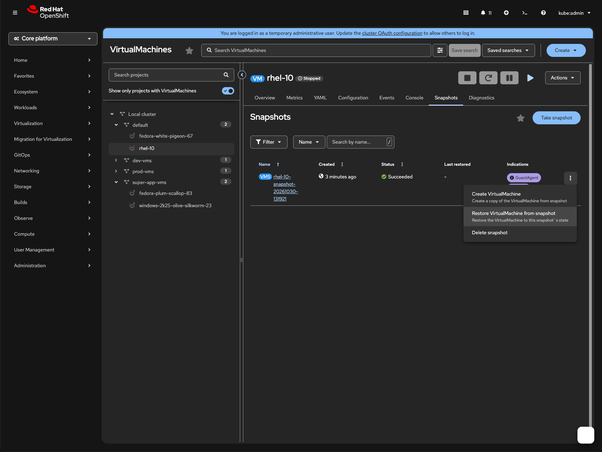

Click Restore to confirm

The VM will show WaitingForVolumeBinding after the restore - the storage only attaches the restored disk once something tries to run on it.

Start the VM again by clicking the Start button (play icon) - this triggers the disk to bind

Once the VM is running, get the login credentials again:

```bash
DATA=$(oc get vm rhel9-vm -n vm-demo -o jsonpath='{.spec.template.spec.volumes[?(@.name=="cloudinitdisk")].cloudInitNoCloud.userData}')
echo "Username: $(echo "$DATA" | grep 'user:' | awk '{print $2}')"
echo "Password: $(echo "$DATA" | grep 'password:' | awk '{print $2}')"
```

Connect to the VM console:

```bash
virtctl console rhel9-vm -n vm-demo
```

> Note
> You may see boot output (kernel messages, systemd services) scrolling. Wait for the rhel9-vm login: prompt to appear, then press Enter if needed. If you can’t scroll back to see the credentials from the previous command, press Ctrl+] to exit the console, reload the Terminal tab, and run the credentials command again.

Log in with the credentials, then verify the restore worked:

```bash
ls /home/rhel/important-data.txt
cat /etc/hostname
```

ls should show No such file or directory - the file you created is gone. cat /etc/hostname should show rhel9-vm (the original hostname), not broken-vm - the hostname change was reverted. The disk was restored to the exact state when you took the snapshot. This is how you roll back a failed OS patch or a broken config change without rebuilding from scratch.

Click the reload button on the Terminal tab to exit the console.


## Summary

*VMs are pods*
  - Same oc commands, same scheduler, same RBAC

*InstanceTypes*
  - Cloud-style provisioning - pick a size, pick an image, deploy

*Same networking*
  - Services and Routes work for VMs and containers

*Same monitoring*
  - Prometheus dashboards show VM and container metrics together

*Live migration*
  - Drain nodes for maintenance without VM downtime

*Cloning*
  - Rapid provisioning from golden images for dev/test/staging

*Snapshots*
  - Point-in-time rollback before patches or upgrades

## Extra Credit

### MTV (Migrate Toolkit for Virtualization)

If you have machines that you want to migrate from a different provider, VMware, Hyper-v, OpenShift Virtualization as examples, there is the Migration Toolkit for Virtualization. This allows you to connect, scan, plan and configure machines to pull them into your managed OpenShift environment.


We are using a ROSA cluster to pull into ARO

TODO: FInish extra credits


virtctl create vm  
--name=win2k25  
--instancetype=u1.medium  
--preference=rhel.10  
--volume-datasource=src:openshift-virtualization-os-images/rhel10

virtctl create vm  
--name=windows-2k25-black-cockroach-34  
--instancetype=u1.xlarge  
--preference=windows.2k25  
--volume-datasource=src:openshift-virtualization-os-images/windows-2k25-server-amd64